<p align="center">
  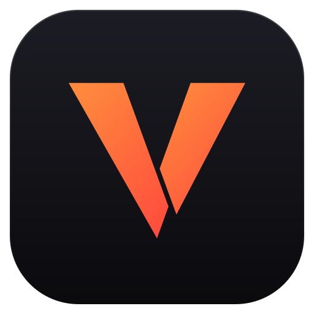
</p>

<h1 align="center">Vengeance</h1>

<p align="center">
  <b>Parallel coding agents, driven beautifully.</b><br>
  Two bundled engines behind one desktop app for Windows, macOS and Linux.
</p>

<p align="center">
  <a href="https://github.com/LuciferMornens/vengeance/releases/latest"></a>
  <a href="https://github.com/LuciferMornens/vengeance/actions/workflows/ci.yml"></a>
  <a href="#download"></a>
  <a href="#download"></a>
  <a href="#download"></a>
  
  
  
  <a href="LICENSE.md"></a>
</p>

<p align="center">
  <a href="#features">Features</a> &middot;
  <a href="#two-engines">Two engines</a> &middot;
  <a href="#download">Download</a> &middot;
  <a href="#getting-started">Getting started</a> &middot;
  <a href="#development">Development</a> &middot;
  <a href="#documentation">Documentation</a>
</p>

<p align="center">
  <picture>
    <source media="(prefers-color-scheme: dark)" srcset="docs/screenshots/hero-dark.png">
    <source media="(prefers-color-scheme: light)" srcset="docs/screenshots/hero-light.png">
    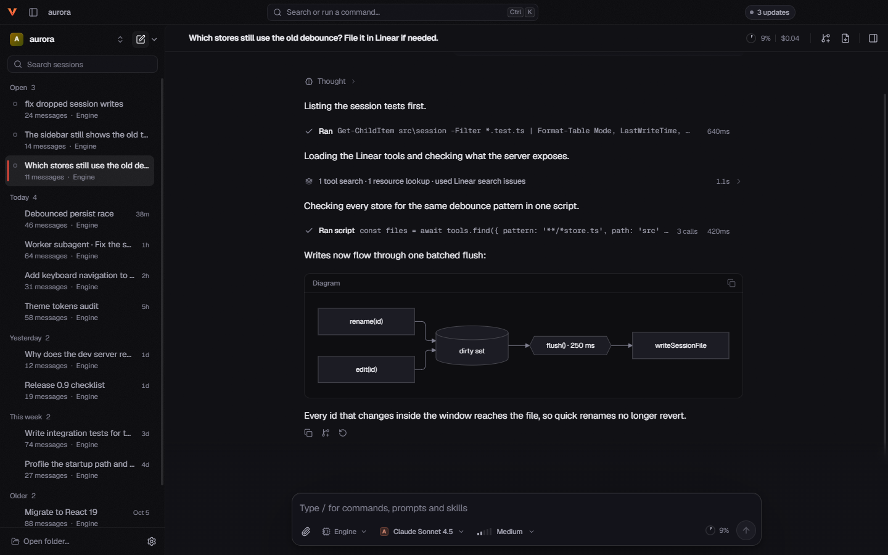
  </picture>
</p>

<p align="center">
  <sub>
    Screenshots are Windows captures of the interface running against the built-in mock engine with
    sample data, not a real model run. Automated captures do not show the Windows 11 Mica backdrop.
  </sub>
</p>

## Why Vengeance

Vengeance is a desktop app for Windows, macOS and Linux that puts two coding-agent engines,
**Engine** and **Engine 2**, behind one interface. Run several agents at once, move a conversation
from one engine to the other, and manage models, accounts, packages and MCP servers from structured
editors instead of only hand-editing JSON. Both engines ship inside the app, so you never install
either one separately.

## Features

### Run agents in parallel

- **Several agents at once.** Sessions run side by side, and live activity indicators in the sidebar
  show which ones are working.
- **Background sessions.** Closing the tab of a saved Engine 2 session leaves it running and listed
  under **Background sessions**; **Stop session** ends one explicitly, and its history stays saved.
  Temporary unsaved Engine 2 sessions stop when closed.
- **Subagents.** Engine 2 has native subagents, with each subagent's history kept beneath its parent
  session and managed under **Engine controls**. Engine delegates through a subagent extension, which
  you can find in **Settings → Extensions**. With one installed, delegated work appears in the
  transcript and in the inspector's Agents panel, where you can answer, steer or stop a worker that
  needs a decision.
- **Workspaces.** Switch workspaces from the sidebar, choose which engine new sessions use, and pick
  up from recent sessions or suggested prompts.

<p align="center">
  <a href="docs/screenshots/subagents.png">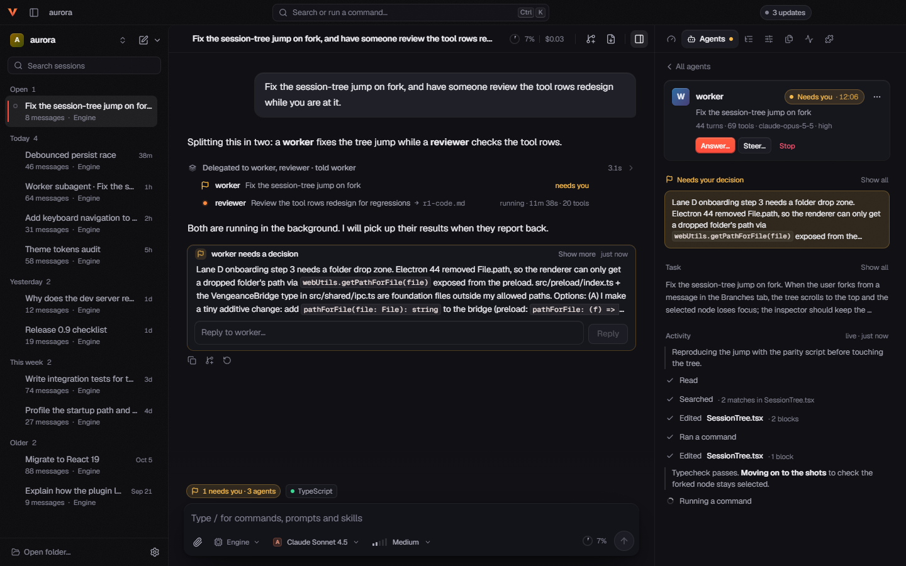</a>
  <br>
  <sub>With a subagent extension installed, a worker that needs a decision surfaces in the transcript and the Engine's Agents panel, with live activity beside it.</sub>
</p>

<p align="center">
  <a href="docs/screenshots/workspaces.png">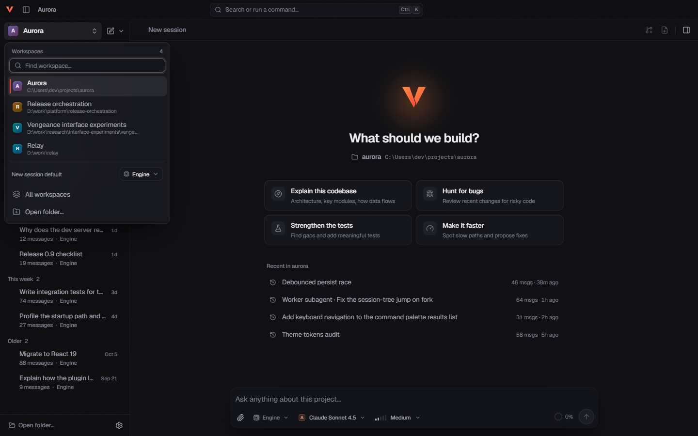</a>
  <br>
  <sub>Jump between workspaces, choose the engine new sessions start with, and resume recent work.</sub>
</p>

### Choose your engine, then change your mind

- **Per workspace or per session.** Starting a session from the composer menu or the sidebar's
  new-session menu never changes the workspace default. Change the default from the workspace
  switcher's **New session default** selector or in **Settings**.
- **Switch mid-conversation.** An idle saved conversation can move between Engine and Engine 2 in the
  same tab. Your draft and the selected branch's history carry over, and the destination uses its own
  model and settings. See [Good to know](#good-to-know) for what does not transfer.

### Read exactly what the agent did

- **Tool cards.** Tool calls render as cards with diffs, an ANSI-colored console and syntax
  highlighting. Consecutive calls group into expandable activity rows.
- **A transcript that renders.** Markdown with tables and highlighted code, plus Mermaid diagrams.
- **Todo list.** When a todo extension or tool supplies a task list, it docks above the composer and
  collapses out of the way.

<p align="center">
  <a href="docs/screenshots/diff-lens.png">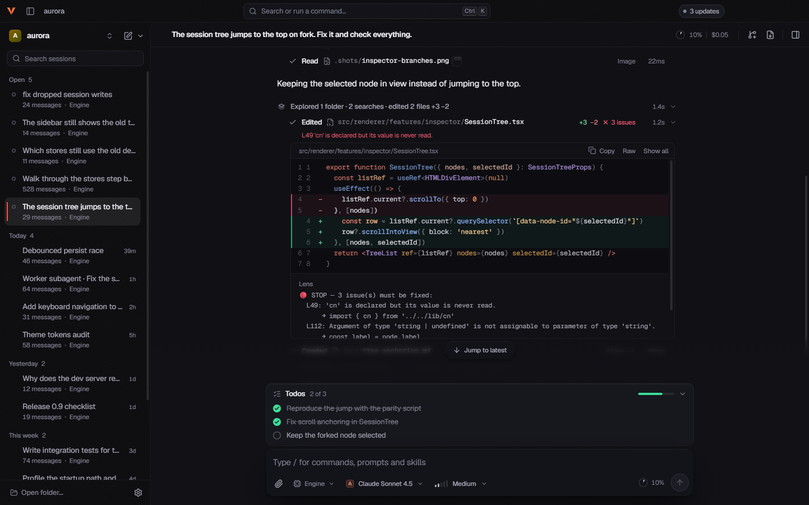</a>
  <br>
  <sub>Edits render as inline diffs with added and removed line counts. Extension tools can attach their own results, such as editor diagnostics.</sub>
</p>

### Stay in control

- **Steer or queue.** While an agent runs, **Enter** steers it and **Alt+Enter** (**Option+Enter**
  on macOS) queues a follow-up. Press **Esc** twice, or click the stop button, to abort.
- **Composer shortcuts.** `/` opens commands, `@` picks a file and `!` runs bash. Model, reasoning and
  speed controls sit in the composer footer.
- **Command palette.** **Ctrl+K** (**Cmd+K** on macOS) searches sessions, models, thinking levels,
  slash commands, skills and settings.

<table>
  <tr>
    <td width="50%" valign="top">
      <a href="docs/screenshots/composer-speed.png">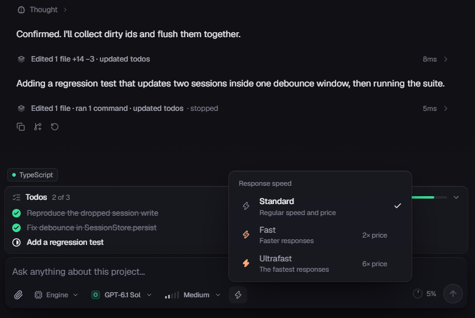</a>
      <br>
      <b>Model, thinking and speed</b><br>
      <sub>Pick the model, thinking level and response speed without leaving the composer. Both engines offer Fast and Ultrafast where the model supports them.</sub>
    </td>
    <td width="50%" valign="top">
      <a href="docs/screenshots/command-palette.png">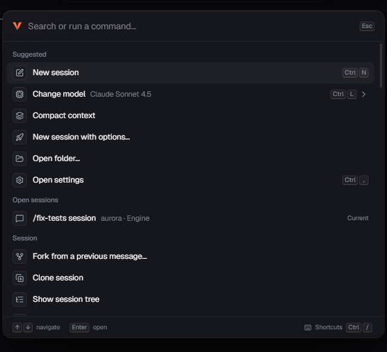</a>
      <br>
      <b>Command palette</b><br>
      <sub>Press Ctrl+K (Cmd+K on macOS) to switch sessions, change models, compact context, fork, clone or open settings.</sub>
    </td>
  </tr>
</table>

### Inspect and manage sessions

- **Inspector.** The right panel has **Overview** (context, cost and tokens), **Branches** (the
  session tree), **Files** and **Timeline** tabs for both engines. Engine sessions add **Agents**,
  **Tools** (choose which tools the model is offered in this session) and **Extensions** tabs.
  Engine 2 sessions have an **Engine controls** button instead, which opens goals, schedules,
  subagents and the rest of the Engine 2 session controls.
- **Session actions.** Fork, clone, rename, export, import, share or delete a session.
- **Sharing.** Engine sharing follows the native Auto, GitHub gist or Radius preference, and a
  consent dialog names the actual destination before anything is uploaded.

<p align="center">
  <picture>
    <source media="(prefers-color-scheme: dark)" srcset="docs/screenshots/inspector-dark.png">
    <source media="(prefers-color-scheme: light)" srcset="docs/screenshots/inspector-light.png">
    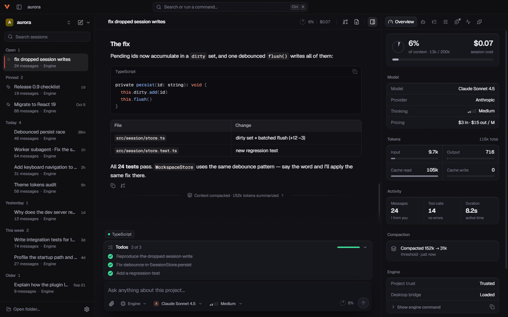
  </picture>
  <br>
  <sub>The Overview tab keeps context use, cost, model, tokens and compaction in view. The dark and light captures show the same screen in different sample states.</sub>
</p>

### Configure visually

- **Structured settings.** Editors for models, providers and accounts, custom models, agent
  behavior, extensions, packages, resources, MCP servers, sessions and context, and keyboard
  shortcuts, with a Raw JSON editor when you want the file itself.
- **Extension gallery (Engine).** **Settings → Extensions** browses community packages from the
  public npm registry. Search or browse topics, read what a package adds, and install it for every
  project or only the open one. **Add your own** installs an extension file or package folder. The
  gallery is read-only until you click **Install** and honors offline mode. Installed packages are
  managed in **Settings → Packages**.
- **Abliteration models (Engine).** All three Abliteration models are included. Connect in
  **Settings → Providers & accounts → Abliteration**, or supply `ABLIT_KEY` in the launch
  environment. Abliterated Model Large V2 offers Minimal, Low, Medium, High, Extra high and Max
  reasoning effort.

<p align="center">
  <a href="docs/screenshots/settings-models.png">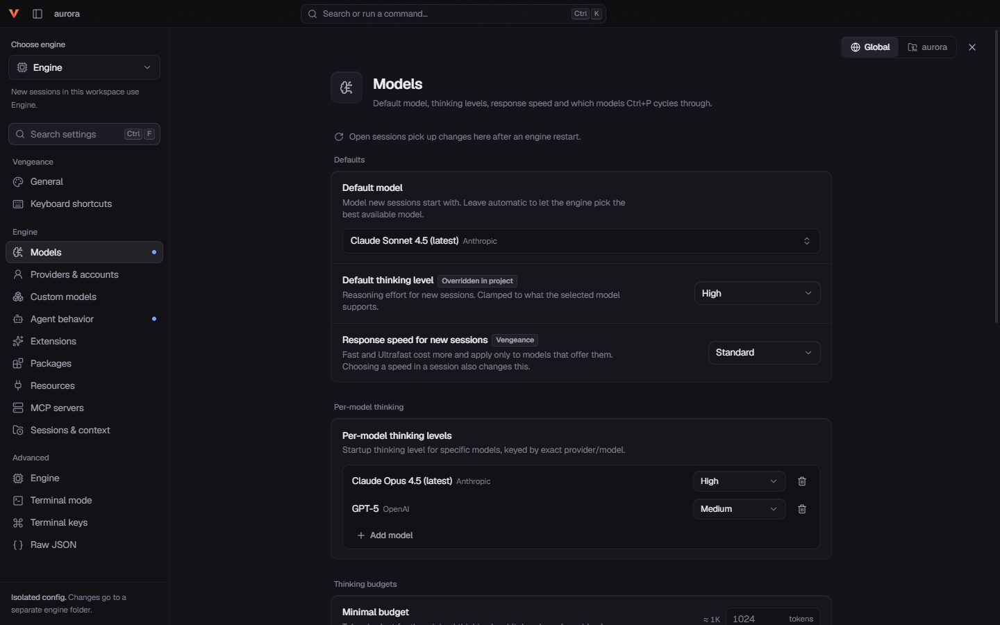</a>
  <br>
  <sub>The Models editor sets the default model, thinking level and response speed, with the other settings sections listed alongside.</sub>
</p>

### Make it yours

- **Themes.** Dark **Obsidian**, light **Bone**, or follow the system.
- **Accents.** Ember, violet, cyan, lime, rose or mono, plus text size, density and motion controls.
- **Window.** A frameless window with each system's own controls: Windows caption buttons with the
  Windows 11 Mica backdrop where supported, the macOS traffic lights and menu bar, and Linux caption
  buttons on floating desktops (none on tiling compositors). Geist fonts are bundled locally.

<table>
  <tr>
    <td width="50%" valign="top">
      <a href="docs/screenshots/themes-obsidian.png">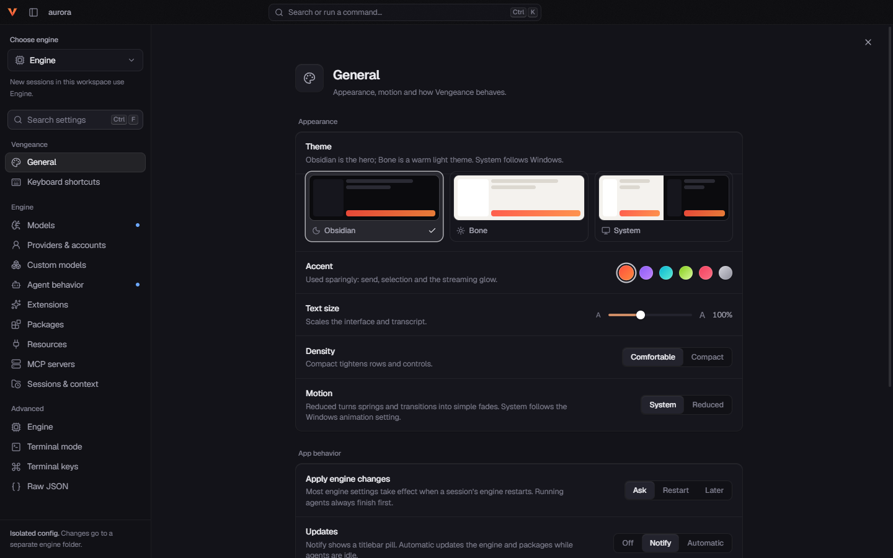</a>
      <br>
      <sub>Obsidian</sub>
    </td>
    <td width="50%" valign="top">
      <a href="docs/screenshots/themes-bone.png">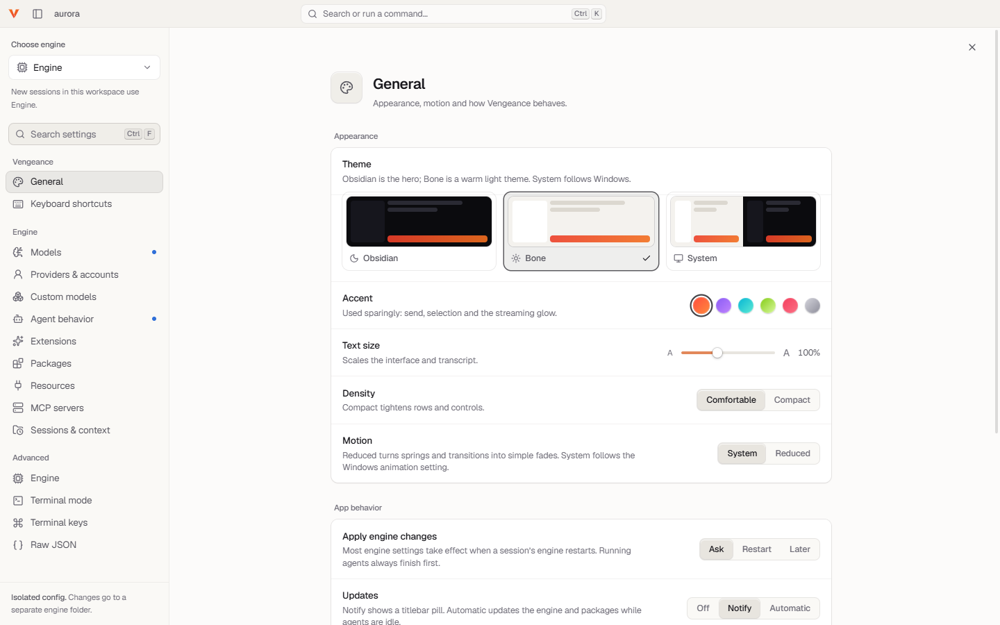</a>
      <br>
      <sub>Bone</sub>
    </td>
  </tr>
</table>

## Two engines

Vengeance bundles two coding-agent engines and presents them as **Engine** and **Engine 2**. Each
has its own agent loop, tools, sign-in, settings and saved sessions. The chat interface, composer,
command palette and inspector are shared.

|            | Engine                                                                                      | Engine 2                                                                                                                                               |
| ---------- | ------------------------------------------------------------------------------------------- | ------------------------------------------------------------------------------------------------------------------------------------------------------ |
| Built from | [pi](https://github.com/earendil-works/pi) `v1.3.0`, build `1.3.0+vengeance.2`              | [Prime Agent](https://github.com/PrimeIntellect-ai/prime-agent) `v0.10.0`, build `0.10.0+vengeance.10`                                                 |
| Runs on    | Electron's Node, so no separate Node install                                                | A native executable that includes its Python kernel package, skills and catalogs                                                                       |
| Sessions   | One process per open session                                                                | Saved resident sessions that survive closing a tab and are listed under **Background sessions**                                                        |
| Highlights | Extension gallery, extension dialogs and widgets, project-trust dialog, Abliteration models | Native subagents, goals, schedules (heartbeat and cron), side questions, trace inspection and export, native Fast and Ultrafast OpenAI speed transport |
| Sign-in    | Its own accounts and settings                                                               | Its own accounts and settings, including subscription sign-in for Anthropic, GitHub Copilot, OpenAI Codex and xAI                                      |

<p align="center">
  <a href="docs/screenshots/engine-2-controls.png">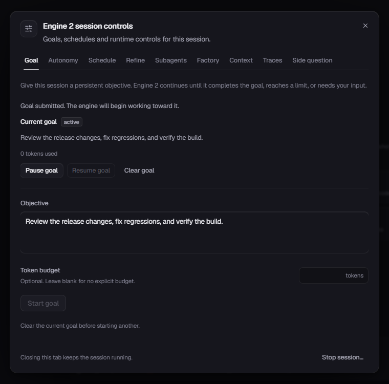</a>
  <br>
  <sub>Engine 2 session controls: goals, autonomy, schedules, refinement, subagents, factory runs, context, traces and side questions.</sub>
</p>

In practice:

- Each engine keeps its own model choice, credentials, settings and saved-session format. Credentials
  are never copied between engines, and secrets are masked before they reach the interface.
- Response speed (Fast and Ultrafast) is available in both engines wherever the model offers it.
- Changing a workspace's default engine does not convert existing sessions.
- Both engines are built from source by Vengeance, natively on each platform. Upstream revisions,
  build versions and the ordered patches are pinned in [engines.lock.json](engines.lock.json), and
  the patches live in [patches/](patches). Engines ship with the app and update with it. There is no
  PATH fallback, and the engines' own self-update is disabled.

## Getting started

### Download

Get the package for your system from the
**[latest release](https://github.com/LuciferMornens/vengeance/releases/latest)**. Every package
includes both engines and the Engine 2 sign-in helper. Vengeance 0.3.0 is the first published
release; earlier versions were local Windows builds.

| Platform            | Package                   | File                                          |
| ------------------- | ------------------------- | --------------------------------------------- |
| Windows x64         | Installer                 | `Vengeance-Setup-<version>.exe`               |
| macOS Apple silicon | Disk image, or zip        | `Vengeance-<version>-mac-arm64.dmg` or `.zip` |
| macOS Intel         | Disk image, or zip        | `Vengeance-<version>-mac-x64.dmg` or `.zip`   |
| Linux x64           | AppImage                  | `Vengeance-<version>-linux-x86_64.AppImage`   |
| Linux x64           | Debian, Ubuntu            | `Vengeance-<version>-linux-amd64.deb`         |
| Linux x64           | Fedora, openSUSE          | `Vengeance-<version>-linux-x86_64.rpm`        |
| Linux x64           | Arch, Omarchy             | `Vengeance-<version>-linux-x64.pacman`        |
| Linux x64           | Any distribution, archive | `Vengeance-<version>-linux-x64.tar.gz`        |
| Linux arm64         | AppImage                  | `Vengeance-<version>-linux-arm64.AppImage`    |
| Linux arm64         | Debian, Ubuntu            | `Vengeance-<version>-linux-arm64.deb`         |
| Linux arm64         | Fedora, openSUSE          | `Vengeance-<version>-linux-aarch64.rpm`       |
| Linux arm64         | Any distribution, archive | `Vengeance-<version>-linux-arm64.tar.gz`      |

There is no pacman package for arm64; on Arch Linux ARM, use the AppImage or the tar.gz. Each
release also lists `SHA256SUMS` and the `latest*.yml` files the in-app updater reads.

### Install

**Windows.** Run the installer. It is not code-signed, so Microsoft Defender SmartScreen may stop it
with "Windows protected your PC". Check the file's SHA-256 first (see
[Verify a download](#verify-a-download)), then choose **More info → Run anyway**. The installer
installs for your user unless you choose all users, lets you choose the install directory, creates
desktop and Start Menu shortcuts, and keeps your app data when you uninstall.

**macOS 13 or later.** Open the dmg and drag **Vengeance** to **Applications**, or unzip the zip and
move the app there. The app is ad-hoc signed but not notarized by Apple, so macOS blocks the first
launch. Either remove the download's quarantine flag:

```bash
xattr -dr com.apple.quarantine /Applications/Vengeance.app
```

or open the app once, then choose **Open Anyway** in **System Settings → Privacy & Security**.

**Linux with glibc 2.35 or newer**, such as Ubuntu 22.04, Debian 12, Fedora 36 or newer. These
commands use the x64 files; on arm64, use the arm64 names from the table.

```bash
# AppImage: no installation, and no FUSE 2 needed (static runtime)
chmod +x Vengeance-<version>-linux-x86_64.AppImage
./Vengeance-<version>-linux-x86_64.AppImage

# Debian, Ubuntu
sudo apt install ./Vengeance-<version>-linux-amd64.deb

# Fedora
sudo dnf install ./Vengeance-<version>-linux-x86_64.rpm

# openSUSE (the rpm has no GPG signature)
sudo zypper install --allow-unsigned-rpm ./Vengeance-<version>-linux-x86_64.rpm

# Arch, Omarchy
sudo pacman -U ./Vengeance-<version>-linux-x64.pacman

# tar.gz: extract anywhere, then run
tar -xzf Vengeance-<version>-linux-x64.tar.gz
./Vengeance-<version>-linux-x64/vengeance
```

The deb, rpm and pacman packages install to `/opt/Vengeance`, add a `vengeance` command and a
launcher entry, and uninstall through your package manager.

- **Wayland and X11.** Vengeance runs natively on Wayland, and on X11. Floating desktops such as
  GNOME and KDE Plasma get window buttons. Tiling compositors such as Hyprland (Omarchy), sway or
  niri manage windows themselves, so Vengeance shows none. Set `VENGEANCE_WINDOW_CONTROLS` to
  `native` or `none` to choose yourself.
- **Secrets.** Environment values Vengeance stores for the engines, such as API keys, are encrypted
  with your desktop's secret store when one is running: a Secret Service such as gnome-keyring or
  KeePassXC, or KWallet on KDE Plasma. Without one they are stored in plain text in
  `app-state.json`, which only your user can read.
- **Ubuntu 24.04 and newer** restrict the user namespaces Chromium's sandbox needs. The deb installs
  an AppArmor profile that allows them for Vengeance. The AppImage and the tar.gz have none, so if
  either does not start there, install the deb instead.

### Verify a download

Every release lists `SHA256SUMS` and has a build provenance attestation from the release workflow.
In the folder that holds your download and `SHA256SUMS`:

```bash
# Linux, or Git Bash on Windows
sha256sum --check --ignore-missing SHA256SUMS
# macOS
shasum -a 256 --check --ignore-missing SHA256SUMS
# Any platform, with the GitHub CLI: checks that this repository's release workflow built the file
gh attestation verify <file> --repo LuciferMornens/vengeance
```

In PowerShell, `Get-FileHash <file>` prints the SHA-256 to compare with the file's line in
`SHA256SUMS`.

### Updates

Vengeance checks for a new version on launch and then on the schedule set in **Settings → General**.
**Updates** there is Off, Notify (the default) or Automatic.

- The **Windows installer** and the **AppImage** update themselves. **Download** in the **Updates**
  sheet fetches the new version, or Automatic fetches it for you, and **Restart** installs it.
- The **macOS** apps and the **deb**, **rpm**, **pacman** and **tar.gz** packages only notify you.
  Their **Download** button opens the version's GitHub release page; install it as you did the first
  time. A Mac app needs an Apple Developer ID signature to replace itself, and a deb, rpm or pacman
  install belongs to your package manager, as a tar.gz install does to you.

### Requirements

To run Vengeance:

- **Windows** x64. The Mica backdrop needs Windows 11 22H2 or newer; the minimum supported Windows
  version is not declared.
- **macOS** 13 or later, on Apple silicon or Intel.
- **Linux** x64 or arm64 with glibc 2.35 or newer, on Wayland or X11.
- Access to a model provider: an API key, a subscription sign-in, or a local model server added
  under **Settings → Custom models**. Vengeance does not supply models.
- No Node, Rust or Python install is needed to load the engines. Package installation and developer
  tools keep their own prerequisites, such as npm, Git or Bash. On macOS and Linux the engines get
  your login shell's environment, so tools your shell profile adds to `PATH` are found even when
  Vengeance starts from the Dock or a launcher.
- [uv](https://docs.astral.sh/uv/) for Engine 2's Python kernel. Engine 2 sets the kernel up with uv
  the first time it needs it, and Vengeance does not install uv for you: put it on `PATH` or in
  `~/.local/bin`. That setup downloads Python and the kernel's packages, so it needs a network
  connection.

To build from source:

- Node 24.19.0 (from [.node-version](.node-version)) with npm 11.17 (`packageManager` in
  [package.json](package.json)), Git and Python 3.
- Rust 1.98.1 through rustup, which [rust-toolchain.toml](rust-toolchain.toml) selects, plus the
  target for your machine: `x86_64-pc-windows-gnu`, `aarch64-apple-darwin`, `x86_64-apple-darwin`,
  `x86_64-unknown-linux-gnu` or `aarch64-unknown-linux-gnu`.
- **Windows:** Git Bash, Rust's GNU host toolchain, a MinGW-w64 GCC, and GNU `objdump` on `PATH`
  (`OBJDUMP` can point at it).
- **macOS:** the Xcode Command Line Tools (`xcode-select --install`).
- **Linux:** a compiler and binutils (`build-essential` and `binutils` on Debian and Ubuntu,
  `base-devel` on Arch). `npm run dist` also needs `rpmbuild` for the rpm and, on x64,
  `bsdtar` for the pacman package (the `rpm` and `libarchive-tools` packages on Debian and Ubuntu).

[CONTRIBUTING.md](CONTRIBUTING.md#prerequisites) has the step-by-step setup for each platform, and
[UPSTREAM.md](UPSTREAM.md) the native toolchain details.

### Build and run

```bash
git clone https://github.com/LuciferMornens/vengeance.git
cd vengeance
npm ci
node node_modules/electron/install.js
npm run dev
```

On Windows, run these from Git Bash. Electron 44 has no install script, so `npm ci` does not
download Electron's runtime, and `npm run dev` stops with "Electron uninstall" until
`node node_modules/electron/install.js` has fetched it. `npm run dev` prepares both engines and the
Engine 2 sign-in helper, then starts the app with hot reload. The first run compiles the native
engines from source and can take several minutes. On a smaller machine, set
`VENGEANCE_NATIVE_BUILD_JOBS=1` to limit build concurrency; the default is four.

On Linux, the engine build refuses native executables that need a glibc newer than 2.35, the release
baseline. On a newer distribution, build in an Ubuntu 22.04 container as CI does, or set
`VENGEANCE_GLIBC_BASELINE=host` for engines you only run on your own machine, and never ship
packages built that way. [CONTRIBUTING.md](CONTRIBUTING.md#linux) covers this and the Ubuntu 24.04
sandbox setting the dev app may need.

When the app opens, add a provider under **Settings → Providers & accounts**. Each engine has its own
accounts and settings.

### Build the packages

```bash
npm run dist
```

This builds the app and packages it in `release/` for the platform and architecture you run it on:
the NSIS installer `Vengeance-Setup-<version>.exe` on Windows, the ad-hoc signed app as a dmg and a
zip on macOS, and the AppImage, deb, rpm and tar.gz on Linux, plus pacman on x64. Each platform
packages on its own machine; nothing is cross-built. To build only some formats, name them, for
example `npm run dist -- AppImage deb`.

Build scripts never publish a release. A local build has no update feed built in unless
`VENGEANCE_UPDATE_FEED` is set for `npm run dist`; release builds use
`https://github.com/LuciferMornens/vengeance/releases/latest/download`. For isolated packaged QA,
run `npm run dist:qa -- --dir`, which packages the app under a separate identity without an
installer.

## Good to know

- **Status.** Vengeance is pre-1.0. [SPEC.md](SPEC.md) is a contract, not a claim of full parity with
  every native engine operation. Known gaps include no desktop UI for the native inter-agent inbox,
  `resume_queue` or queue reordering, no dashboard for native background shell jobs, no fully live
  reload for Engine 2, and unqualified synchronization with external clients. See the
  [engine audit](docs/ENGINE-AUDIT-2026-10-14.md).
- **Platforms.** 0.3.0 is the first published release and the first built for macOS and Linux. The
  screenshots and the qualification reports before it come from Windows x64 local builds.
- **Engine 2 updates.** Installing a newer app does not replace a running Engine 2 resident. Its
  session notice offers an explicit, guarded restart, and **Close tab** leaves saved residents
  available in **Background sessions**.
- **Reconnects.** After a disconnect, Engine 2 restores committed history and its busy and Stop state
  immediately. Partially streamed text from an unfinished turn is not guaranteed to replay.
- **Switching engines.** A recovery copy stays with the source engine. Native goals, schedules and
  child workers do not transfer, and nonempty ephemeral sessions cannot switch.
- **Subagent histories.** Engine 2 subagent histories appear beneath their native parent, with
  accessible orphan histories when the parent is outside the current view. Independent sessions and
  same-depth forks stay separate.
- **Sharing.** Radius links use organization visibility.
- **Trust.** Engine has an explicit project-trust dialog. Engine 2 has no per-project trust decisions
  and no extension dialogs.
- **Performance.** Figures in the release notes are local fixture measurements, not guarantees.

## Development

Vengeance is Electron with electron-vite, React, strict TypeScript, Tailwind CSS 4, Radix, Motion,
Zustand and Playwright. Exact versions are pinned in [package.json](package.json). On Windows, use
Git Bash. Install with `npm ci`, then `node node_modules/electron/install.js`.

Before you finish a change, run the gates in order and open the screenshots:

```bash
npm run typecheck
npm run build
npm run checks
npm run shots
```

`npm run checks` needs the engines that `npm run build` stages for your machine. `npm run shots`
runs mock-engine screenshot scenarios against the completed build and writes PNGs to `.shots/`,
which Git ignores. Finish renderer builds before launching UI QA, and run GUI suites serially. Read
[AGENTS.md](AGENTS.md) and [SPEC.md](SPEC.md) before changing anything, and
[UPSTREAM.md](UPSTREAM.md) before touching an engine, helper or compatibility path.

### CI and releases

[CI](.github/workflows/ci.yml) runs on every pull request and every push to `main`. It typechecks,
builds the app and lints the workflows, and it builds the engines the way releases do, Linux in an
Ubuntu 22.04 container for the glibc 2.35 baseline. Then it runs `npm run build`, `npm run checks`
and `npm run shots` on Windows x64, macOS arm64 and Linux x64, and uploads the screenshots as
workflow artifacts. Pull requests also get a dependency review.

The [release workflow](.github/workflows/release.yml) runs when a `v<version>` tag is pushed. It
builds and packages all five platforms on their own runners, checks the baked update feed, the glibc
baseline and the macOS signatures, smoke-tests a packaged build on each platform and install-tests
the deb, rpm and pacman packages. Then it creates a draft GitHub release with every package, `SHA256SUMS` and a
provenance attestation, which the maintainer reviews and publishes. Pull requests that change
packaging, the engines or the workflow run it as a dry run that never publishes. The maintainer
steps are in [CONTRIBUTING.md](CONTRIBUTING.md#releases).

<details>
<summary><b>All npm scripts</b></summary>

| Command                                     | Purpose                                                                                                 |
| ------------------------------------------- | ------------------------------------------------------------------------------------------------------- |
| `npm run dev`                               | Prepare engines and helper, then start electron-vite with renderer hot reload.                          |
| `npm run build`                             | Prepare engines and helper, then write application bundles to `out/`.                                   |
| `npm run dist`                              | Build the app and this platform's packages in `release/`. Never publishes.                              |
| `npm run dist:qa -- --dir`                  | Package an unpacked app under a separate QA identity, with no installer.                                |
| `npm run engines:prepare`                   | Reconstruct editable, patched upstream checkouts under `.engine-staging/source`.                        |
| `npm run build:engines`                     | Build or verify both engine payloads from `engines.lock.json`.                                          |
| `npm run build:auth`                        | Build or verify the Engine 2 sign-in helper.                                                            |
| `npm run typecheck`                         | Type-check main, preload and shared code, then renderer and shared code.                                |
| `npm run checks`                            | Run the fast application contract checks.                                                               |
| `npm run shots`                             | Run mock-engine screenshot scenarios. Add a name to filter them.                                        |
| `npm run qa`, `npm run qa:smoke`            | Run application QA suites. `qa:smoke` uses the real Engine with a scripted provider.                    |
| `npm run e2e:real`                          | Tiny live-provider smoke test in a temporary workspace. Needs provider access.                          |
| `npm run e2e:packaged`                      | The same smoke test against the unpacked packaged app. Needs `npm run dist` first.                      |
| `npm run e2e:bridge`, `e2e:mcp`, `e2e:tree` | Real-engine checks for the bridge, MCP reconnects and very long session trees.                          |
| `npm run icons`                             | Regenerate committed icons from `build/icon.svg`.                                                       |
| `npm run perf`                              | Measure the performance footprint (Windows only). Needs the QA package from `npm run dist:qa -- --dir`. |

There is no `npm test`, `npm start` or lint script.

</details>

## Documentation

| Document                                                                                           | Purpose                                                                                 |
| -------------------------------------------------------------------------------------------------- | --------------------------------------------------------------------------------------- |
| [SPEC.md](SPEC.md)                                                                                 | Product and architecture contract; requirements are not a full-parity completion claim. |
| [AGENTS.md](AGENTS.md)                                                                             | Repository working rules and required gates.                                            |
| [Contributing](CONTRIBUTING.md)                                                                    | Per-platform setup, gates, pull requests and the release steps.                         |
| [Security policy](SECURITY.md)                                                                     | Supported versions, private vulnerability reports and download verification.            |
| [Development guide](docs/FOUNDATION.md)                                                            | Setup, commands, current architecture and process ownership.                            |
| [Design system](docs/DESIGN-SYSTEM.md)                                                             | Tokens, shared components and visual conventions.                                       |
| [Upstream maintenance](UPSTREAM.md)                                                                | Engine reconstruction, patch rebasing and release qualification.                        |
| [Engine patch guide](patches/pi/README.md) / [Engine 2 patch guide](patches/prime-agent/README.md) | Native changes and distribution contracts.                                              |
| [Native helper](resources/prime-auth/README.md)                                                    | Engine 2 sign-in helper build, protocols and dependency updates.                        |
| [QA harness](scripts/qa/README.md)                                                                 | Temporary accounts, local providers, packaged tests and native transitions.             |

The app version is defined in [package.json](package.json).

### Release notes

**Latest: [Vengeance 0.3.2](docs/RELEASE-0.3.2.md)** covers the changes and checks for the current
version. The packages themselves are on the
[GitHub release](https://github.com/LuciferMornens/vengeance/releases/latest).

<details>
<summary><b>Qualification history</b></summary>

These reports describe the exact versions, hashes and observations at their stated checkpoints.
They are evidence, not current installation status or promises that local generated artifacts still
exist. Use the lockfile and current guides for maintenance instructions. Reports before 0.3.0 cover
local Windows x64 builds only.

- [Release 0.3.1](docs/RELEASE-0.3.1.md): app self-update works again; Vengeance License 1.0.
- [Release 0.3.0](docs/RELEASE-0.3.0.md): first published release, and the first for macOS and
  Linux.
- [Release 0.2.15](docs/RELEASE-0.2.15.md): Engine extension gallery and restart offers that name
  what changed.
- [Release 0.2.14](docs/RELEASE-0.2.14.md): stable engine updates and Engine 2 subagent families.
- [Release 0.2.13](docs/RELEASE-0.2.13.md): native conversation handoff between engines.
- [Release 0.2.12](docs/RELEASE-0.2.12.md): conversation deletion, workspace navigation and long histories.
- [Release 0.2.11](docs/RELEASE-0.2.11.md): native Abliteration models and full Large V2 reasoning.
- [Release 0.2.10](docs/RELEASE-0.2.10.md): collapsible Engine todo list above the composer.
- [Release 0.2.9](docs/RELEASE-0.2.9.md): native OpenAI compaction keeps task continuation;
  docked Engine todo list.
- [Release 0.2.8](docs/RELEASE-0.2.8.md): responsive shell and composer layout; retained release baseline.
- [Release 0.2.7](docs/RELEASE-0.2.7.md): Engine 2 model isolation, native settings merges and
  resident session controls.
- [Engine audit — 14 October 2026](docs/ENGINE-AUDIT-2026-10-14.md): upstream comparison, parent-model
  isolation, concurrent settings preservation, local checkout synchronization and remaining gaps.
- [Engine 2 stable-base audit — 16 October 2026](docs/PRIME-STABLE-AUDIT-2026-10-16.md): upstream
  release identity and why the locked stable base was kept.
- [OpenAI native compaction](docs/openai-native-compaction.md): the compaction-trigger correction
  for both engines.
- [Resident-session update behavior — 0.2.6](docs/ENGINE2-RESIDENT-SESSIONS.md): live versus selected
  versions, capability lookup, Close tab and Stop session.
- [Image capabilities — 0.2.6](docs/ENGINE2-IMAGE-CAPABILITIES.md): native model switches, generated
  prompts and Python image bindings.
- [Native qualification — 0.2.5](docs/NATIVE-QUALIFICATION-0.2.5.md): Windows runtime fixes and
  isolated native workspace qualification.
- [Engine 2 speed — 0.2.4](docs/ENGINE2-SPEED-0.2.4.md): native Fast/Ultrafast transport and eligibility.
- [Extension compatibility — 0.2.3](docs/EXTENSION-COMPATIBILITY-0.2.3.md): upstream SDK version identity.
- [Bundled engines — 0.2.2](docs/BUNDLED-ENGINES-0.2.2.md): initial source-built engine distribution.

</details>

## License

Vengeance is free to use, copy, change and share under the [Vengeance License](LICENSE.md), a
source-available license. In short:

- What you make with Vengeance, such as the code its agents write, is yours and owes no royalty. So
  is using it as a tool at work or for client projects.
- When you share Vengeance, keep the copyright notice, the license and the third-party notices with
  it. A modified version, or anything else built from Vengeance's code, that you share also shows
  "Based on Vengeance by LuciferMornens" with a link to this repository where its users can see it,
  marks what you changed, and has its own name and logo. A build that only packages Vengeance for a
  platform or fixes bugs may keep its name and logo (LICENSE.md section 3.5).
- If you receive money or other value for Vengeance itself, a modified version of it, or a product
  that builds its code in, for example by selling, hosting or bundling it, or through ads,
  sponsorships or donations for it, and that revenue, before costs and across your whole company
  group, is more than USD 10,000 in a month, you pay 15% of the part above USD 10,000.

[LICENSE.md](LICENSE.md) has the full terms; the summary above does not replace them. It is not an
OSI-approved open-source license. The bundled engines, the patches to them in [patches/](patches)
and their dependencies keep their own MIT and other licenses, which travel with each runtime (see
[UPSTREAM.md](UPSTREAM.md)).

## Acknowledgements

Engine is built from [pi](https://github.com/earendil-works/pi) by earendil-works, and Engine 2 from
[Prime Agent](https://github.com/PrimeIntellect-ai/prime-agent) by PrimeIntellect-ai. Vengeance is an
independent desktop app; building on these projects does not imply endorsement by their authors.
